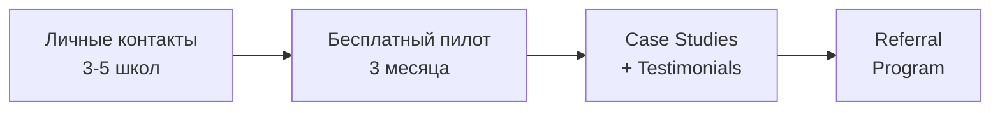

# 🏢 Экспертный бизнес-аудит: Sprachschul-Manager

> **Дата:** 02.11.2026
> **Формат:** Оценка → Проблема → Как исправить
> **Роль рецензента:** CEO / Product Manager, B2B SaaS для образования (Европа)

---

## 1. 📊 Оценка продукта: Конкурентоспособность

### Что уже есть (и это хорошо)

| Модуль | Состояние | Комментарий |
|--------|-----------|-------------|
| Управление преподавателями | ✅ Зрело | Создание, редактирование, профиль с расчётом з/п, замена учителя |
| Расчёт зарплат (Payroll) | ✅ Зрело | 6 уровней ставок (45/60/90 мин, индивидуальная, групповая, стандартная), поздняя отмена с % оплаты |
| Портал учителя (My Portal) | ✅ Сильно | Мобильный недельный календарь, KPI-карточки, GoBD-конформный PDF-печатный документ с подписями, Google Calendar интеграция |
| Управление курсами | ✅ Хорошо | Группы/индивидуальные, расписание, привязка к комнатам, управление учениками (active/trial/waiting) |
| Управление учениками | ✅ Хорошо | Контактные данные родителей, monthly payments tracking, Excel-импорт, привязка к нескольким курсам |
| Учёт прогулов | ✅ Хорошо | Отчёт по прогулам с фильтрами, привязка к урокам |
| Финансовый обзор | ✅ Хорошо | 6-месячный бар-чарт (доходы vs расходы), список должников с кнопкой напоминания, запись платежей |
| i18n | ✅ Готово | DE / EN / RU — полная локализация через next-intl |
| DSGVO / Безопасность | ✅ Хорошо | RLS на всех таблицах, mandanten-trennung, Impressum, Datenschutzerklärung, серверы во Франкфурте |
| Landing Page | ✅ Профессионально | Чистый B2B-дизайн, правильный messaging, CTA-кнопки, Trust Badges |
| Тёмная тема | ✅ Есть | Через next-themes, все компоненты поддерживают dark mode |
| Мобильная адаптивность | ✅ Хорошо | Отдельные card-views для мобилки на каждой странице, bottom-nav |

### Общая оценка зрелости

```
┌─────────────────────────────────────────────────────────┐
│  MVP readiness:                          ████████░░ 80% │
│  Competitive parity с TutorCruncher:     ██████░░░░ 60% │
│  Readiness для ценника 100 €/мес:        █████░░░░░ 50% │
│  DSGVO / Trust readiness:                █████████░ 90% │
│  Mobile Teacher Experience:              ████████░░ 80% │
│  School Owner's "I'll buy" moment:       █████░░░░░ 45% │
└─────────────────────────────────────────────────────────┘
```

> [!IMPORTANT]
> **Вердикт:** Продукт — это крепкий MVP с правильной архитектурой и приятным UI. Но для того чтобы директор школы сказал **"Ich kaufe das"**, не хватает 3-4 **критических** модулей, которые он ожидает от системы за 49-99 €/мес. Без них продукт выглядит скорее как «красивый учёт часов», а не как ERP.

---

## 2. 🚨 Главные ошибки и проблемы

### 2.1 Бизнес-логические проблемы

#### ❌ Проблема: Нет биллинга и автоматической генерации счетов

**Оценка:** Самый большой GAP.

В текущей реализации есть таблица `monthly_payments` и ручная кнопка «Zahlung erfassen» (запись платежа). Но:
- **Нет автоматической генерации** записей monthly_payments для всех активных учеников на начало месяца.
- **Нет Rechnung / Invoice** — ни PDF, ни вообще никакой генерации. Для B2B в Германии это showstopper.
- **Нет SEPA-Lastschrift** интеграции (или хотя бы экспорта SEPA XML для банка).
- Владелец школы должен вручную нажимать «Оплачено» для каждого ученика каждый месяц.

**Как исправить:**
1. Автогенерация `monthly_payments` для всех active-учеников с `custom_monthly_price` или `course.monthly_price` первого числа каждого месяца (через cron/Supabase Edge Function).
2. PDF-Rechnung генерация (GoBD-конформная, с fortlaufende Rechnungsnummer).
3. SEPA XML экспорт (файл для загрузки в онлайн-банкинг) — это killer feature для немецких школ.

---

#### ❌ Проблема: Нет понятия «Vertrag» (контракт/договор с учеником)

**Оценка:** Критическая для немецкого рынка.

В Германии языковые школы работают по модели подписки с Kündigungsfrist (сроком расторжения). Текущая модель данных не учитывает:
- **Начало и конец контракта** (start_date, end_date)
- **Период уведомления** (notice_period)
- **Статус контракта** (active, paused, cancelled)
- **Пробный период** (trial) — есть как статус в `student_courses`, но нет бизнес-логики вокруг

**Как исправить:** Добавить таблицу `contracts` или расширить `student_courses` полями: `start_date`, `end_date`, `auto_renew`, `notice_period_weeks`, `cancellation_date`.

---

#### ❌ Проблема: Нет Wartepiste / Warteliste workflow

**Оценка:** Средняя, но важна для ценообразования.

Есть статус `waiting` в `student_courses`, но **нет уведомлений** и **нет автоматического перевода** ученика из Warteliste в активный когда место освободилось. Это важно для групповых курсов с `max_capacity`.

**Как исправить:** При удалении ученика из курса — автоматически проверять waiting list и предлагать перевод. Email-уведомление родителям.

---

#### ⚠️ Проблема: Расчёт зарплат хороший, но нет Minijob / SV-логики

**Оценка:** Средняя. Для MVP допустимо, но конкуренты (TutorCruncher) это предлагают.

В Германии большинство преподавателей языковых школ — это либо Honorarkräfte (freelancers), либо Minijobber (520€). Текущая система не отслеживает:
- **Порог 520€** для Minijob
- **Предупреждение** при превышении лимита часов
- **Steuer-ID / Tax ID** преподавателя

**Как исправить:** Добавить в профиль учителя: `employment_type` (honorar / minijob / teilzeit), `tax_id`. Показывать progress bar до 520€ для Minijobber с предупреждением.

---

### 2.2 UX-ошибки

#### ⚠️ Проблема: Dashboard перегружен SQL-запросами (6 параллельных)

**Оценка:** Техническая, но влияет на UX.

Dashboard грузит ВСЕ уроки, ВСЕХ учителей, ВСЕ курсы, ВСЮ attendance, ВСЕ payments, ВСЕХ студентов — одним запросом `Promise.all`. Для школы с 500+ учениками это будет тормозить.

**Как исправить:**
- Создать Supabase Database View или RPC-функцию для агрегированных KPI.
- Пагинация для списка уроков.
- Кэширование через `unstable_cache` / ISR.

---

#### ⚠️ Проблема: Нет поиска и фильтрации на ключевых страницах

**Оценка:** UX-блокер для школ с > 50 учениками.

Страницы Students, Lessons, Teachers не имеют **search bar**, **фильтрации по курсу**, **сортировки**. Когда учеников 200+, найти нужного — мучение.

**Как исправить:** Добавить компонент поиска с debounce, фильтр по курсу (combobox), сортировку по столбцам.

---

#### ⚠️ Проблема: Нет Onboarding / Setup Wizard

**Оценка:** Критическая для конверсии Trial → Paid.

Новый пользователь после регистрации видит пустой дашборд с `CreateOrganizationCard`. Нет пошагового гида: «Создай школу → Добавь курс → Добавь учителя → Добавь ученика → Проведи первый урок». Это значит **90%+ churn в первые 48 часов**.

**Как исправить:** Step-by-step onboarding wizard с прогресс-баром. Показывать до тех пор, пока не выполнены все 4 шага. Можно скипнуть.

---

#### ⚠️ Проблема: Помощь (Help Center) — статична

**Оценка:** Низкая, но влияет на self-service retention.

[Help Center](file:///c:/Users/123/Desktop/WRK/src/app/(app)/help/page.tsx) — хорошее начало (FAQ accordion), но нет: видео-туториалов, live chat, knowledge base, feedback widget.

---

## 3. 💎 Killer Features: ТОП-5 фич для ценника 100 €/мес

### 🥇 Feature #1: Automatische Rechnungserstellung (Автоматическая генерация счетов)

**Почему это #1:** В Германии без Rechnung нет бизнеса. Каждая школа, которая берёт деньги, обязана выставлять счёт. Сейчас они делают это в Word/Excel. **Это самая болезненная проблема** (Schmerz).

**Что реализовать:**
- Авто-генерация PDF-Rechnung первого числа каждого месяца
- GoBD-конформная нумерация (fortlaufende Rechnungsnummer)
- Кастомизация: логотип школы ✅ (уже есть), банковские реквизиты, USt-ID
- Массовая рассылка по email
- **Бонус:** SEPA XML экспорт для Lastschrift (автосписание)

**ROI:** Один этот модуль оправдывает 49 €/мес ценник. Конкуренты (TutorCruncher) берут за это отдельно.

---

### 🥈 Feature #2: Automatisches Klassenbuch mit BAMF-Export

**Почему:** Большая часть немецких Sprachschulen работает с BAMF (Integrationskurse). BAMF требует строгий формат отчётности: Anwesenheitsliste, Unterrichtsstunden-Nachweis. Если ваш продукт генерирует BAMF-совместимые отчёты — школа не уйдёт от вас НИКОГДА.

**Что реализовать:**
- Экспорт Anwesenheitsliste в BAMF-формате (PDF/CSV)
- Поле «Kursart» (Integrationskurs, Berufssprachkurs, Privat)
- Tracking UE (Unterrichtseinheiten) vs астрономические часы (45 мин = 1 UE)
- Генерация «Teilnahmebescheinigung» (сертификат посещения)

**ROI:** Это moat. Ни TutorCruncher, ни Teachworks не знают что такое BAMF. Это ваш UNFAIR ADVANTAGE.

---

### 🥉 Feature #3: Eltern-Portal / Schüler-Portal (Родительский портал)

**Почему:** У вас уже есть отличный Lehrer-Portal. Логичное расширение — портал для родителей/учеников с:
- Просмотром расписания ребёнка
- Историей посещений
- Просмотром и оплатой счетов (Stripe/PayPal)
- Уведомлениями об отмене занятий
- Возможностью отменить урок (с учётом Kündigungsfrist)

**ROI:** Это переводит продукт из категории «инструмент для школы» в категорию «платформа», что x2-x3 к perceived value и justification ценника.

---

### 4️⃣ Feature #4: Kalender-Integration & Stundenplan-Generator

**Почему:** Google Calendar иконка уже есть, но это ссылки на ручное добавление. Нужно:
- **iCal feed** для учителя (уже есть endpoint `/api/calendar/[teacher_id]` ✅) — отлично!
- **Automatische Stundenplan-Erstellung**: алгоритм, который при добавлении `course_schedules` автоматически генерирует `lessons` на X недель вперёд
- **Vertretungsplanung** (планирование замещений): UI для массового переназначения уроков при болезни учителя

**ROI:** Сейчас каждый урок вносится вручную через AddLessonDialog. Для школы с 20 курсами × 4 урока/неделю = 80 ручных записей/мес. Это БОЛЬ.

---

### 5️⃣ Feature #5: Benachrichtigungen & Kommunikationsmodul

**Почему:** Владелец школы тратит 30% времени на коммуникацию: SMS родителям, email учителям, напоминания о платежах. Сейчас есть только `mailto:` ссылка в модуле должников.

**Что реализовать:**
- Email-Templates для типовых сценариев (отмена урока, напоминание, подтверждение записи)
- Массовая email-рассылка по курсу
- Push-уведомления (или хотя бы email) учителю при назначении замены
- WhatsApp Business API интеграция (опционально, но killer в Германии)

---

## 4. 🚀 Go-to-Market стратегия: Германия, 0 € бюджет

### Фаза 1: Validation & Seed Users (Месяц 1-2)



1. **Cold Outreach через VHS/IHK каталоги.** В Германии 900+ Sprachschulen зарегистрированы в IHK и VHS-каталогах. Они публичны. Написать 50 писем лично, не спам, а конкретное предложение: *«Ich habe gesehen, dass Sie Integrationskurse anbieten. Wir haben eine Software, die Ihre BAMF-Abrechnung automatisiert. Darf ich Ihnen in 15 Minuten zeigen, wie?»*

2. **LinkedIn Content-Marketing (DE).** Публиковать посты на немецком: «Как я автоматизировал расчёт зарплат для языковой школы», «5 Fehler bei der Honorarabrechnung». Тэги: #Sprachschule #Bildung #Digitalisierung #BAMF.

3. **Google My Business + SEO.** Создать лендинг с SEO под запросы:
   - «Sprachschule Verwaltungssoftware»
   - «Honorarabrechnung Sprachschule»
   - «BAMF Anwesenheitsliste Software»
   - «Sprachschule ERP»

### Фаза 2: Organic Growth (Месяц 3-6)

4. **Партнёрства с Steuerberatern** (налоговыми консультантами). Школы доверяют своему Steuerberater больше, чем рекламе. Если Steuerberater рекомендует — школа покупает. Предложить бесплатный аккаунт налоговому консультанту + реферальный бонус.

5. **Бесплатный инструмент как Lead Magnet:** Выпустить бесплатный калькулятор: *«Honorarrechner für Sprachschulen»* — простая страница, где школа вводит количество учителей и часов и видит, сколько она тратит на ручную работу vs автоматизация. Собирать email.

6. **Присутствие на Messen (выставках):** 
   - **EXPOLINGUA Berlin** — ежегодная выставка для языковых школ
   - **Didacta** — крупнейшая образовательная выставка Европы
   - Можно участвовать как «Startup-Aussteller» за минимальную плату или бесплатно

### Фаза 3: Scale (Месяц 6-12)

7. **Freemium Model.** 
   - **Gratis:** до 5 учеников, 2 учителя (полный функционал)
   - **Starter (29 €):** до 30 учеников
   - **Professional (79 €):** безлимит, BAMF-Export, Rechnungen
   - **Enterprise (149 €):** несколько филиалов, API, приоритетная поддержка

8. **Referral:** Каждая подключённая школа получает 1 месяц бесплатно за рекомендацию, которая привела к подписке.

---

## 5. Итоговая карта приоритетов

| Приоритет | Фича | Влияние на конверсию | Сложность |
|-----------|-------|---------------------|-----------|
| 🔴 P0 | Авто-генерация Rechnung (PDF) | ⭐⭐⭐⭐⭐ | Средняя |
| 🔴 P0 | Авто-генерация уроков из расписания | ⭐⭐⭐⭐⭐ | Низкая |
| 🔴 P0 | Поиск и фильтрация на всех страницах | ⭐⭐⭐⭐ | Низкая |
| 🔴 P0 | Onboarding Wizard | ⭐⭐⭐⭐ | Низкая |
| 🟡 P1 | BAMF-Export (Anwesenheitsliste) | ⭐⭐⭐⭐⭐ | Средняя |
| 🟡 P1 | SEPA XML экспорт | ⭐⭐⭐⭐ | Средняя |
| 🟡 P1 | Vertrag / Контракт модель | ⭐⭐⭐⭐ | Средняя |
| 🟢 P2 | Eltern-Portal | ⭐⭐⭐⭐ | Высокая |
| 🟢 P2 | Email-Benachrichtigungen | ⭐⭐⭐ | Средняя |
| 🟢 P2 | Minijob 520€ Tracking | ⭐⭐⭐ | Низкая |

---

## 6. Честный вывод

> [!TIP]
> **Что у вас хорошо:** Архитектура (Next.js 15 + Supabase RLS), качество UI (тёмная тема, мобильная адаптация, print-ready PDF), бизнес-логика payroll (6 уровней ставок — это серьёзно), i18n на трёх языках. Это НЕ игрушечный проект — это продукт с потенциалом.

> [!WARNING]
> **Что мешает продажам:** Продукт решает боль «учёт часов и зарплат», но НЕ решает боль «выставление счетов и сбор денег». А именно вторая боль заставляет владельца школы искать софт. Рекомендую следующие 2-4 недели посвятить исключительно модулю **Rechnungserstellung + автогенерация уроков из расписания**. После этого у вас появится product-market fit для первых 10 платящих клиентов.

> [!CAUTION]
> **Главный риск:** Конкуренты (TutorCruncher, Teachworks) — англоязычные и не знают немецких реалий (BAMF, DSGVO, Minijob, SEPA, GoBD). Это ваше окно. Но окно закрывается: если кто-то из них сделает немецкую локализацию, вы потеряете преимущество. Действуйте быстро, сфокусировано, и закройте **BAMF + Rechnungen** первыми.
